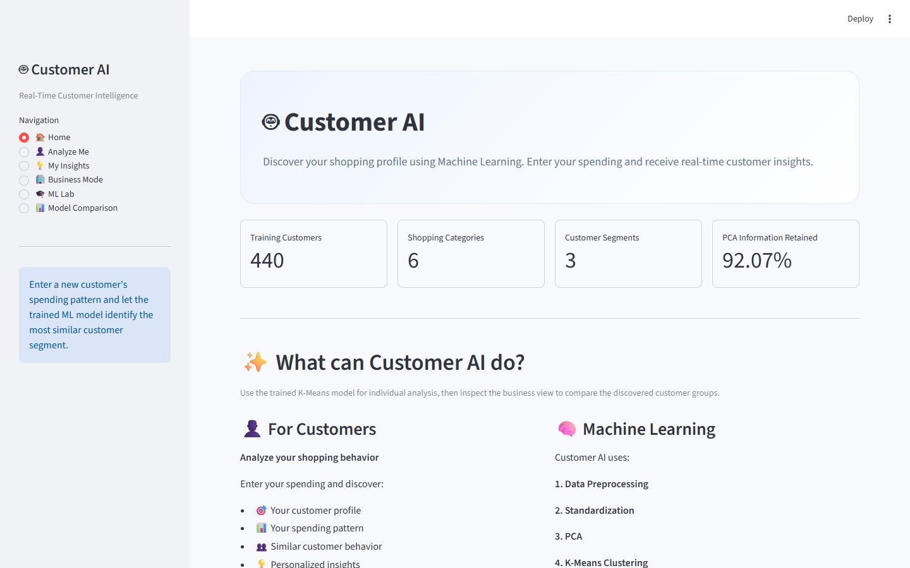
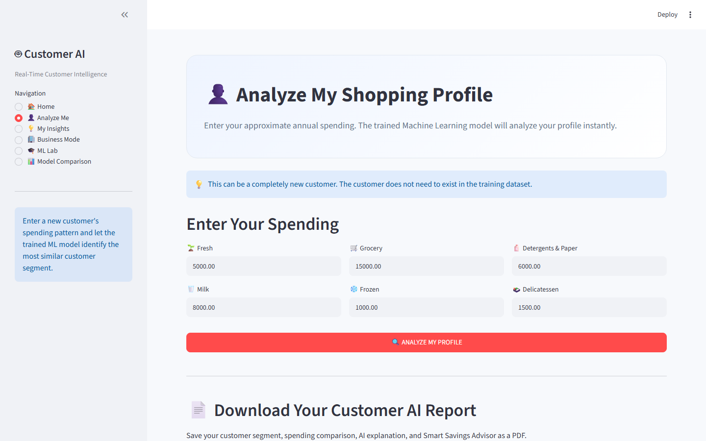
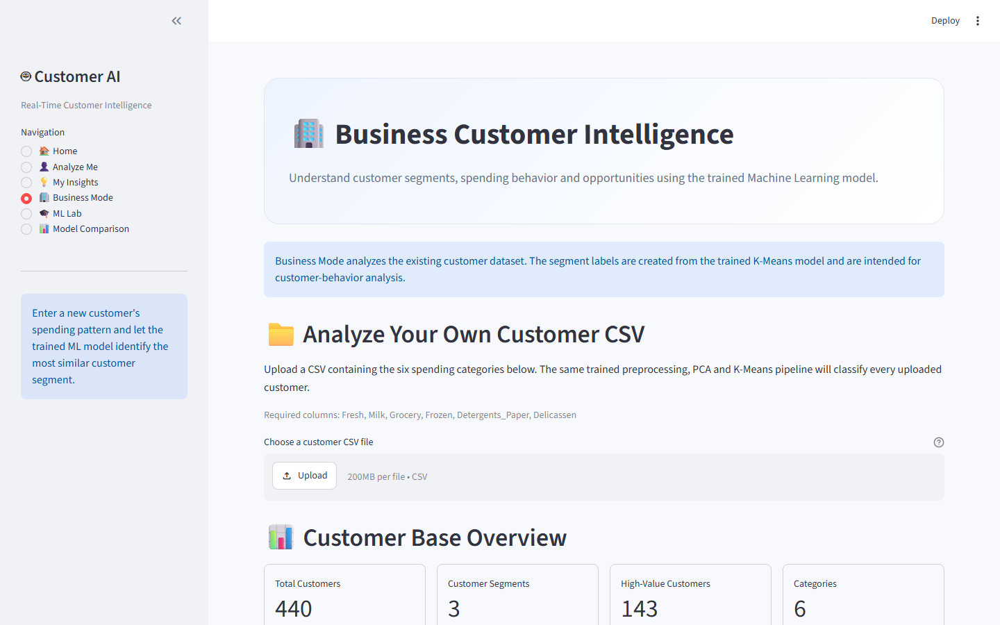
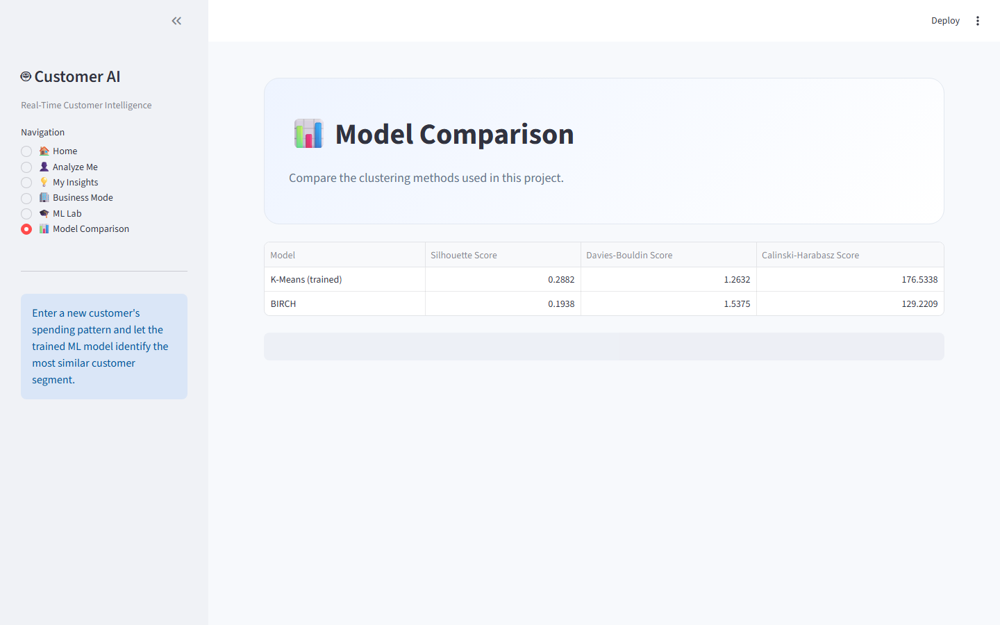
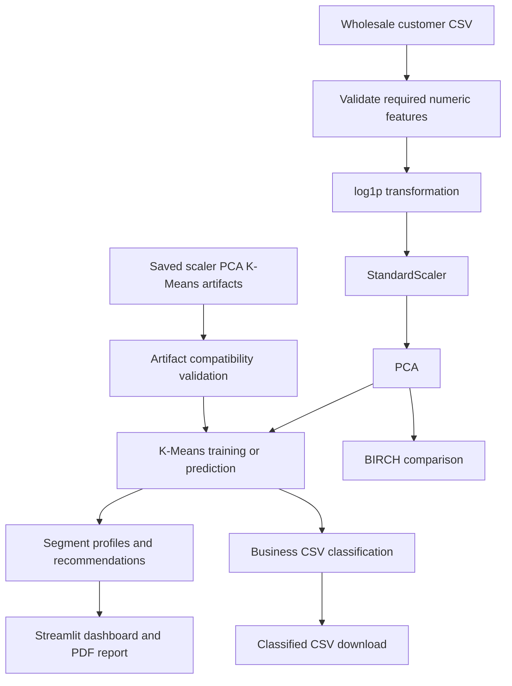

# Customer AI

Customer AI is a Streamlit portfolio project for customer segmentation and spending-pattern analysis. It applies an unsupervised learning pipeline to the UCI Wholesale Customers dataset and exposes the result through a dashboard for individual analysis, business CSV classification, model comparison, and PDF reporting.

## Problem and motivation

Businesses often need a first-pass view of customer behavior before designing targeted promotions or account strategies. This project demonstrates how to turn tabular spending data into reproducible customer segments while keeping the transformation and prediction paths consistent.

The segments are analytical groupings, not verified customer identities, predictions of future revenue, or causal business recommendations.

## Features

- Real-time customer segmentation with K-Means.
- Consistent log transformation, standardization, and PCA at training and prediction time.
- Segment profiles, spending comparisons, insights, and what-if simulation.
- Business CSV upload with required-column, numeric, finite, non-negative, and empty-input validation.
- Downloadable classified CSV files and customer PDF reports.
- ML Lab views for preprocessing, PCA, K-Means, and BIRCH.
- Live K-Means versus BIRCH evaluation using silhouette, Davies-Bouldin, and Calinski-Harabasz metrics.
- Pytest coverage and a GitHub Actions test workflow.

## Screenshots

These screenshots were captured from the local Streamlit application using
the checked-in dataset and model artifacts:









## Technology stack

Python, pandas, NumPy, scikit-learn, joblib, Streamlit, Plotly, ReportLab, Matplotlib, and pytest.

## Machine learning methodology

```text
Wholesale customer spending
        -> validate required numeric features
        -> log1p transformation
        -> StandardScaler
        -> PCA (4 components by default)
        -> K-Means (3 clusters by default)
        -> descriptive segment profile
```

K-Means is the deployed prediction model because it supports assigning new customers to existing clusters. BIRCH is evaluated as a comparison method on the same transformed feature representation. Clustering metrics measure separation and compactness; they are not classification accuracy.

## Architecture and workflow



## Project structure

```text
Customer_AI/
├── app.py                         # Streamlit entry point
├── src/
│   ├── customer_ai.py             # Validation, transforms, predictions, metrics
│   ├── train_model.py             # Reproducible model training CLI
│   └── test_realtime.py           # Manual prediction smoke script
├── tests/
│   ├── test_customer_ai.py        # Unit tests for data and ML behavior
│   ├── test_app_smoke.py          # Headless Streamlit startup test
│   └── test_app_uploads.py        # Headless CSV upload interaction tests
├── data/                          # Source and experiment CSV files
├── models/                        # Existing serialized model artifacts
├── test_data/                     # Small sample upload CSV
├── notebooks/                     # Experiment scripts
├── outputs/                       # Generated local reports and plots
├── requirements.txt
├── .github/workflows/ci.yml
└── .streamlit/config.toml         # Streamlit hosting defaults
```

## Installation

Python 3.11 or newer is required by the pinned Streamlit and scikit-learn versions. Windows PowerShell:

```powershell
git clone https://github.com/TarunBonu547/Customer_AI.git
cd Customer_AI
py -m venv .venv
.\.venv\Scripts\Activate.ps1
python -m pip install --upgrade pip
python -m pip install -r requirements.txt
```

If PowerShell execution policy prevents activation, run the commands from Command Prompt or invoke `.venv\Scripts\python.exe` directly.

General Python environments can use the equivalent `python -m venv .venv`, the activation command for that shell, and `python -m pip install -r requirements.txt`.

## Run the application

From the repository root:

```powershell
streamlit run app.py
```

The application loads the checked-in CSV and model files using paths relative to the repository, so it does not depend on a personal computer path.

To retrain the models with the default dataset:

```powershell
python src\train_model.py
```

Training options include `--clusters`, `--components`, and `--random-state`. Training writes the existing three model files plus `models/metadata.pkl`.

## Input CSV format

Business uploads must contain these six columns:

```text
Fresh,Milk,Grocery,Frozen,Detergents_Paper,Delicassen
```

Values must be numeric, finite, and non-negative. Additional columns, such as an account identifier, are retained in the classified download. A sample file is available at [test_data/customer_ai_test_business.csv](test_data/customer_ai_test_business.csv).

## Evaluation

The Model Comparison view computes metrics from the current transformed data and model labels. It reports:

- Silhouette score: higher is generally better.
- Davies-Bouldin score: lower is generally better.
- Calinski-Harabasz score: higher is generally better.

Run the application or the training command locally to obtain measurements for the exact model artifacts in use. No performance or business-impact claims are inferred from these unsupervised metrics.

Verified on the checked-in artifacts with scikit-learn `1.9.0`:

| Model | Silhouette | Davies-Bouldin | Calinski-Harabasz |
| --- | ---: | ---: | ---: |
| K-Means | 0.2882 | 1.2632 | 176.5338 |
| BIRCH | 0.1938 | 1.5375 | 129.2209 |

Across K-Means seeds `0, 7, 19, 42, 99`, the Silhouette score ranged from
`0.2870` to `0.2900` and the adjusted Rand index against the first seed ranged
from `0.9386` to `0.9541`. These are stability checks, not evidence of
business impact or predictive accuracy.

## Testing

```powershell
python -m pytest -q
```

The suite covers validation failures, numeric normalization, feature-order consistency, prediction behavior, clustering metric edge cases, model artifact persistence, invalid and corrupted artifacts, Streamlit startup, customer analysis, and Business Mode upload interactions.

## Deployment preparation

The repository includes `.streamlit/config.toml` with headless hosting defaults. For Streamlit Community Cloud:

1. Push the repository to GitHub after reviewing the local diff.
2. Create a new app and select the repository and branch.
3. Set the main file path to `app.py`.
4. Confirm `requirements.txt`, `data/wholesale_customers.csv`, and the three compatible files in `models/` are committed.
5. Deploy, then test Home, Analyze Me, Business Mode upload, Model Comparison, and PDF generation from the hosted URL.

The app is prepared for deployment but has not been deployed or assigned a live URL. Do not add secrets unless a future integration requires them.

Before deploying, run `python -m pytest -q` and `streamlit run app.py` in a clean environment. This repository does not claim to be deployed or live.

## Known limitations and future work

- Cluster labels and descriptive names can change after retraining because unsupervised cluster IDs have no fixed semantic meaning.
- The current model is trained on one wholesale spending dataset and may not generalize to other industries, currencies, or time periods.
- There is no ground-truth label for validating business usefulness.
- Future work could add model versioning, drift monitoring, validation against a time-based holdout, and a formal segment naming configuration.

No license file is currently included; no license is claimed by this README.
