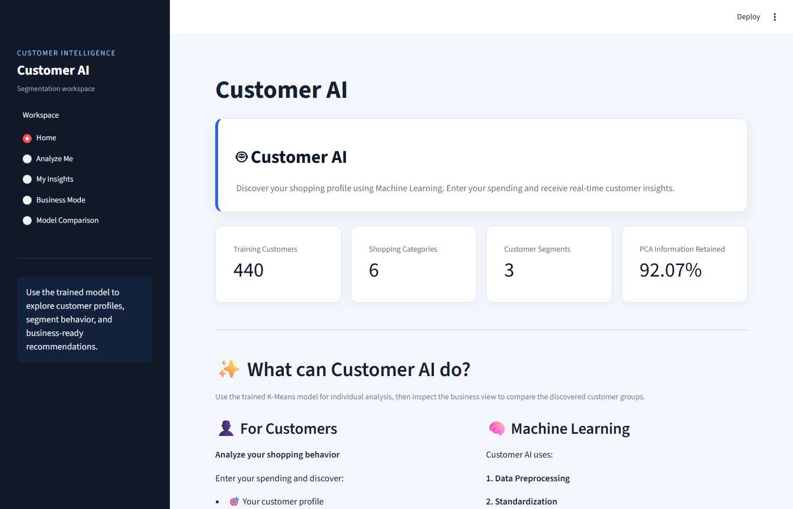
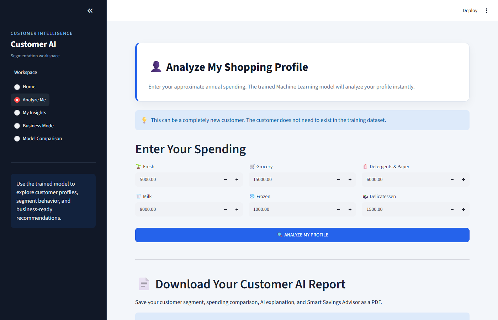
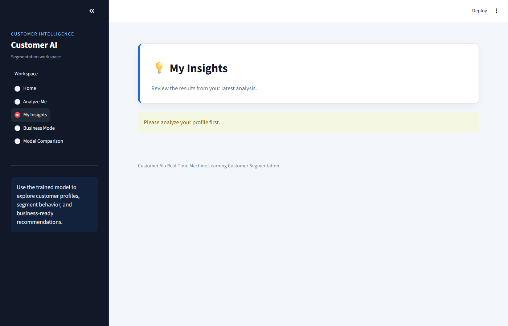
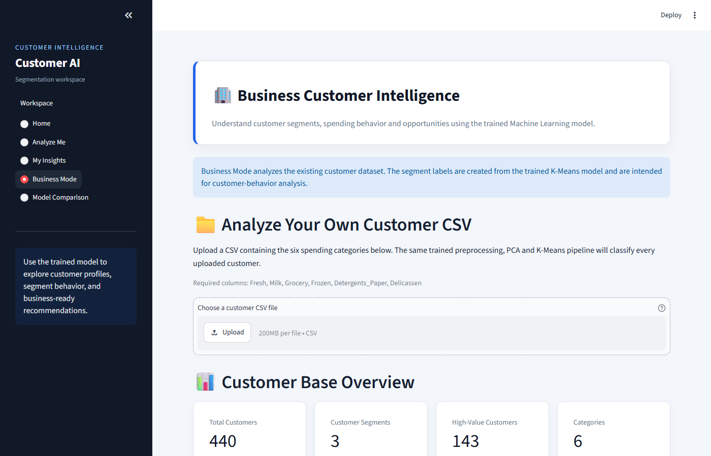
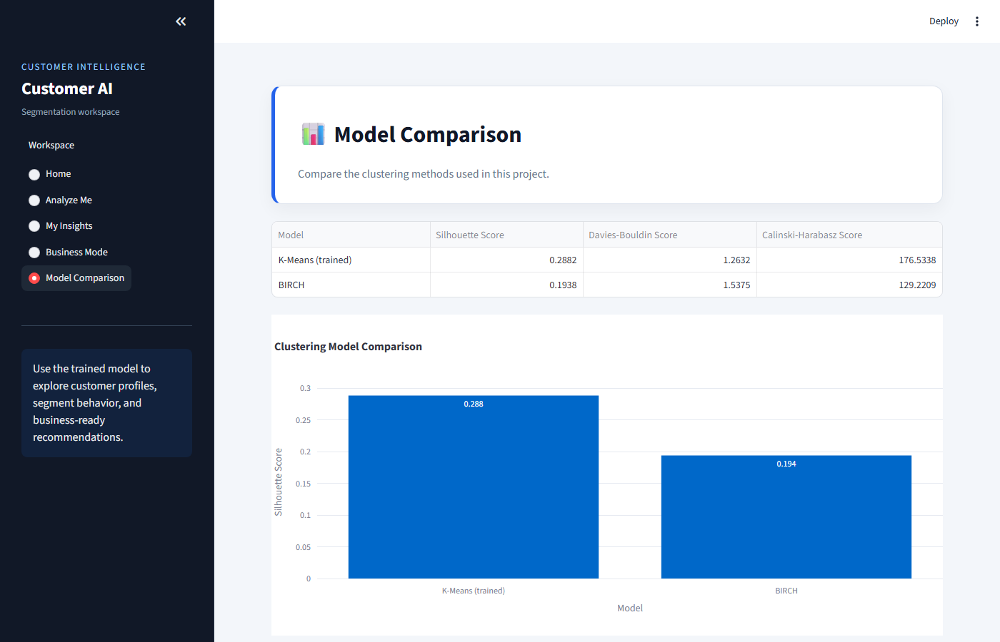

# Customer AI

Customer AI is a Streamlit portfolio project for customer segmentation and spending-pattern analysis. It applies an unsupervised learning pipeline to the UCI Wholesale Customers dataset and exposes the results through a modern SaaS-style dashboard for individual analysis, business CSV classification, model comparison, and PDF reporting.

The segments are analytical groupings, not verified customer identities, predictions of future revenue, or causal business recommendations.

## Table of contents

- [Problem and motivation](#problem-and-motivation)
- [Feature highlights](#feature-highlights)
- [Application screenshots](#application-screenshots)
- [How it works](#how-it-works)
- [Machine learning models](#machine-learning-models)
- [Technology stack](#technology-stack)
- [Project structure](#project-structure)
- [Installation and setup](#installation-and-setup)
- [Run the application](#run-the-application)
- [Using the application](#using-the-application)
- [Sample data](#sample-data)
- [Testing](#testing)
- [Model evaluation](#model-evaluation)
- [Limitations and future improvements](#limitations-and-future-improvements)
- [Author and repository](#author-and-repository)

## Problem and motivation

Businesses often need a first-pass view of customer behavior before designing targeted promotions or account strategies. Customer AI demonstrates how to turn tabular spending data into reproducible customer segments while keeping the transformation and prediction paths consistent.

The app is organized into five pages:

1. **Home** — dashboard overview and pipeline explanation.
2. **Analyze Me** — real-time spending analysis for a single customer, with segment prediction, insights, recommendations, a what-if simulator, and PDF report download.
3. **My Insights** — review of the most recent customer analysis.
4. **Business Mode** — customer-base segment distribution, spending profiles, and CSV upload with classification and download.
5. **Model Comparison** — side-by-side clustering evaluation of K-Means and BIRCH.

## Feature highlights

- Real-time customer segmentation with a trained K-Means model.
- Consistent log transformation, standardization, and PCA at training and prediction time.
- Segment profiles, spending comparisons, insights, and what-if simulation.
- Business CSV upload with required-column, numeric, finite, non-negative, and empty-input validation.
- Downloadable classified CSV files and customer PDF reports.
- Home explains the preprocessing and clustering pipeline used by the app.
- Live K-Means versus BIRCH evaluation using silhouette, Davies-Bouldin, and Calinski-Harabasz metrics.
- Pytest test suite covering validation, prediction, clustering metrics, artifact persistence, and Streamlit interactions.

## Application screenshots

Captured from the running Streamlit application using the checked-in dataset and model artifacts.

| Home | Analyze Me |
| --- | --- |
|  |  |

| My Insights | Business Mode |
| --- | --- |
|  |  |

| Model Comparison |
| --- |
|  |

## How it works

Customer analysis follows a single, consistent preprocessing and clustering pipeline:

1. **Input validation** — spending values are checked for required columns, numeric type, finiteness, and non-negativity.
2. **Log transformation** — `log1p` is applied to reduce skew in spending distributions.
3. **Standardization** — `StandardScaler` centers and scales the transformed features.
4. **Dimensionality reduction** — PCA (4 components) projects the data into a lower-dimensional representation.
5. **Clustering** — the trained K-Means model assigns the customer to one of three segments.
6. **Insights and reporting** — segment assignment is compared against segment averages to produce insights, recommendations, a smart savings advisor, and an optional PDF report.

For business uploads, the same pipeline classifies every row in an uploaded CSV and returns segment labels, distribution charts, and a downloadable classified file.

## Machine learning models

Customer AI uses two clustering methods:

- **K-Means** (`sklearn.cluster.KMeans`) — the deployed prediction model. Trained with `k-means++` initialization, `n_init=10`, on PCA-transformed data. Supports assigning new customers to existing clusters, which makes it suitable for real-time analysis and business CSV classification.
- **BIRCH** (`sklearn.cluster.Birch`) — evaluated only for comparison in the Model Comparison page. Not used for prediction.

Both models operate on the same transformed feature representation: log-transformed, standardized, then PCA-reduced. Clustering metrics measure separation and compactness; they are not classification accuracy, and cluster labels carry no fixed semantic meaning.

The training pipeline (`src/train_model.py`) fits `StandardScaler`, `PCA(n_components=4)`, and `KMeans(n_clusters=3)`, then persists `scaler.pkl`, `pca.pkl`, `kmeans.pkl`, and `metadata.pkl` under `models/`.

## Technology stack

| Dependency | Version constraint |
| --- | --- |
| Python | 3.11 or newer |
| numpy | >= 1.24 |
| pandas | >= 2.0 |
| scikit-learn | == 1.9.0 |
| joblib | >= 1.3 |
| streamlit | >= 1.30 |
| plotly | >= 5.15 |
| reportlab | >= 4.0 |
| matplotlib | >= 3.7 |
| pytest | >= 8.0 |

See `requirements.txt` for the full dependency list.

## Project structure

```text
Customer_AI/
├── app.py                         # Streamlit entry point (5-page dashboard)
├── src/
│   ├── customer_ai.py             # Validation, transforms, predictions, metrics
│   ├── train_model.py             # Reproducible model training CLI
│   └── test_realtime.py           # Manual prediction smoke script
├── tests/
│   ├── test_customer_ai.py        # Unit tests for data and ML behavior
│   ├── test_app_smoke.py          # Headless Streamlit startup test
│   └── test_app_uploads.py        # Headless CSV upload interaction tests
├── data/                          # Source and experiment CSV files
├── models/                        # Serialized model artifacts
├── test_data/                     # Small sample upload CSV
├── screenshots/                   # README application screenshots
├── notebooks/                     # Experiment scripts
├── outputs/                       # Generated local reports and plots
├── requirements.txt
├── .streamlit/config.toml         # Streamlit hosting defaults
└── .gitignore
```

Virtual environments, caches, and other generated clutter are excluded by `.gitignore`.

## Installation and setup

Python 3.11 or newer is required by the pinned Streamlit and scikit-learn versions.

### Windows (PowerShell)

```powershell
git clone https://github.com/TarunBonu547/Customer_AI.git
cd Customer_AI
py -m venv .venv
.\.venv\Scripts\Activate.ps1
python -m pip install --upgrade pip
python -m pip install -r requirements.txt
```

If PowerShell execution policy prevents activation, run the commands from Command Prompt or invoke `.\.venv\Scripts\python.exe` directly.

### macOS / Linux

```bash
git clone https://github.com/TarunBonu547/Customer_AI.git
cd Customer_AI
python -m venv .venv
source .venv/bin/activate
python -m pip install --upgrade pip
python -m pip install -r requirements.txt
```

## Run the application

From the repository root:

```powershell
streamlit run app.py
```

The application loads the CSV and model files using paths relative to the repository, so it does not depend on a personal computer path.

To retrain the models with the default dataset:

```powershell
python src\train_model.py
```

Training options include `--clusters`, `--components`, and `--random-state`. Training writes `scaler.pkl`, `pca.pkl`, `kmeans.pkl`, and `metadata.pkl` to `models/`.

## Using the application

### Home
Review the dashboard metrics (training customers, shopping categories, segments, PCA variance retained) and a summary of what Customer AI can do, including the machine-learning pipeline overview.

### Analyze Me
Enter approximate annual spending across the six categories (Fresh, Milk, Grocery, Frozen, Detergents_Paper, Delicassen). The trained model predicts your customer segment instantly, then shows:
- Your customer profile and segment
- Total spending and strongest category
- A spending chart and a comparison against your segment average
- Insights explaining why the segment was chosen
- Personalized suggestions and a Smart Savings Advisor
- A What-If Simulator to explore how changed spending affects your segment
- A downloadable PDF customer report

### My Insights
Review the results from your latest analysis, including your segment, spending, recommendations, and Smart Savings Advisor. Requires that you analyze a profile first.

### Business Mode
View the customer-base segment distribution, segment spending profiles, and business insights for the checked-in dataset. You can also upload your own customer CSV (the same six spending columns) to classify every uploaded customer, view segment distribution and spending charts, and download a classified CSV.

### Model Comparison
Compare K-Means (trained) against BIRCH using silhouette, Davies-Bouldin, and Calinski-Harabasz scores computed from the current transformed data and model labels.

PDF report generation is supported from the Analyze Me page after a profile has been analyzed.

## Sample data

The sample/test upload file is `test_data/customer_ai_test_business.csv`. It contains 10 customers across the six required columns:

```text
Fresh,Milk,Grocery,Frozen,Detergents_Paper,Delicassen
```

Use it with Business Mode to verify CSV upload, classification, and classified-CSV download. Values must be numeric, finite, and non-negative; additional columns (such as an account identifier) are retained in the classified download.

The primary dataset is `data/wholesale_customers.csv` (UCI Wholesale Customers, 440 customers).

## Testing

Run the test suite from the repository root:

```powershell
python -m pytest -q
```

**Result:** 20 passed. The suite covers validation failures, numeric normalization, feature-order consistency, prediction behavior, clustering metric edge cases, model artifact persistence, invalid and corrupted artifacts, Streamlit startup, customer analysis, and Business Mode upload interactions.

## Model evaluation

The Model Comparison view computes metrics from the current transformed data and model labels. It reports:

- Silhouette score — higher is generally better.
- Davies-Bouldin score — lower is generally better.
- Calinski-Harabasz score — higher is generally better.

These metrics describe cluster separation and compactness, not predictive accuracy or business impact. Values below were measured against the checked-in artifacts with scikit-learn 1.9.0; retraining may produce different results.

| Model | Silhouette | Davies-Bouldin | Calinski-Harabasz |
| --- | ---: | ---: | ---: |
| K-Means (trained) | 0.2882 | 1.2632 | 176.5338 |
| BIRCH | 0.1938 | 1.5375 | 129.2209 |

The checked-in PCA pipeline retains approximately 92.07% of the variance across 4 components. No performance or business-impact claims are inferred from these unsupervised metrics.

## Limitations and future improvements

- Cluster labels and descriptive names can change after retraining because unsupervised cluster IDs have no fixed semantic meaning.
- The model is trained on one wholesale spending dataset and may not generalize to other industries, currencies, or time periods.
- There is no ground-truth label for validating business usefulness.
- Future work (not implemented) could add model versioning, drift monitoring, validation against a time-based holdout, and a formal segment naming configuration.

## Author and repository

- GitHub repository: https://github.com/TarunBonu547/Customer_AI

No live demo or deployment URL is claimed. No contact information is published beyond the repository above.
